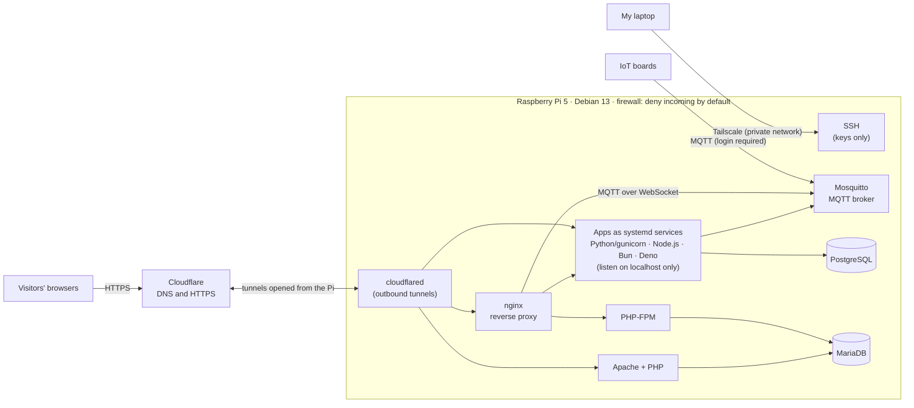

# Homelab: a self-hosted Linux server on a Raspberry Pi

I run a Raspberry Pi 5 at home as a production server. It hosts my own projects (IoT Studio, a blog,
an invoicing app and two small tools) and a few client websites. This repo documents how it is set
up and run: the architecture, the services, the security setup, and problems I found and fixed.

> Real domain names, IP addresses, port numbers, usernames and client details are left out or replaced
> with placeholders such as `example.com`, `<api-port>` and `user`. No passwords, keys or credentials
> are in this repo.

## Hardware

| | |
|---|---|
| Board | Raspberry Pi 5 Model B, 4 GB RAM |
| Storage | 250 GB SATA SSD over USB (the Pi boots from it, no SD card) |
| OS | Debian 13 "trixie" (Raspberry Pi OS), arm64 |
| Swap | 2 GB zram (compressed RAM) |
| Network | Wired Ethernet |

## Architecture

- **No open router ports for the websites.** `cloudflared` on the Pi opens outbound connections to
  Cloudflare, and Cloudflare sends visitors' requests back through them. HTTPS ends at Cloudflare.
- **Apps and databases listen on localhost only.** Only nginx, Apache or cloudflared talk to them, from the Pi itself.
- **Admin access goes over Tailscale**, a private WireGuard network. SSH accepts keys only.
- **The firewall denies all incoming traffic** except what is listed in [docs/security.md](docs/security.md).

More detail, including how a request travels: [docs/architecture.md](docs/architecture.md).

## Stack

| Area | Software |
|---|---|
| OS and process management | Debian 13, systemd (services and timers), cron |
| Web | nginx (reverse proxy), Apache (one PHP site), PHP-FPM |
| Apps | Python + gunicorn (Flask), Node.js, Bun, Deno |
| Databases | PostgreSQL, MariaDB |
| MQTT | Mosquitto with the Dynamic Security plugin |
| Public access | Cloudflare Tunnel |
| Admin access | Tailscale (Tailscale SSH), OpenSSH |
| Security | ufw, fail2ban, unattended-upgrades, systemd sandboxing, bubblewrap |

## What runs here

| Service | How it runs |
|---|---|
| IoT Studio (landing page, app for schools and colleges, public demo) | nginx in front of a Flask API on gunicorn, plus a background worker; PostgreSQL; MQTT |
| IoT Studio Makers (app and admin panel) | its own API, worker, database and MQTT broker |
| IoT Studio blog | Node.js app |
| Content Hub (team content planner) | Node.js app, heavily sandboxed by systemd |
| Invio (invoicing) | SvelteKit on Bun, with an API on Deno |
| Licence Manager | Apache + PHP, MariaDB |
| Client websites | PHP sites on nginx + PHP-FPM, MariaDB, each with its own Cloudflare tunnel |

Every service is a systemd unit. Docker and PM2 are not used. Details: [docs/services.md](docs/services.md).

## Things worth a look

- **Deploys with automatic rollback** ([scripts/iotstudio-update.sh](scripts/iotstudio-update.sh)):
  database backup, new release folder next to the old one, migrations, symlink switch, health check,
  and roll back if any step fails.
- **Nightly database backups and a restore script** ([scripts/iotstudio-backup.sh](scripts/iotstudio-backup.sh),
  [scripts/iotstudio-restore.sh](scripts/iotstudio-restore.sh)).
- **Untrusted code runs in a sandbox** ([scripts/arduino-sandbox.sh](scripts/arduino-sandbox.sh)): students'
  Arduino code is compiled inside bubblewrap, with no network and no view of the app's secrets.
- **A security review** found and fixed four real problems, including SSH password login that a
  cloud-init file had quietly turned back on. See [docs/troubleshooting.md](docs/troubleshooting.md).

## Docs

| | |
|---|---|
| [docs/architecture.md](docs/architecture.md) | Diagram, why Cloudflare Tunnel, how a request travels |
| [docs/services.md](docs/services.md) | Services, timers and cron jobs; backups and deploys |
| [docs/setup.md](docs/setup.md) | How to rebuild the server, and how I add or remove a site |
| [docs/security.md](docs/security.md) | The security setup that is actually in place |
| [docs/troubleshooting.md](docs/troubleshooting.md) | Problems I found and how I fixed them |
| [configs/](configs/) | Sanitized copies of real config files |
| [scripts/](scripts/) | Scripts for backups, restore, deploys and the compiler sandbox |

## Next steps

- CI: run tests automatically before a deploy
- Monitoring dashboards and alerts
- A second backup location
- Try containers for the next new app
