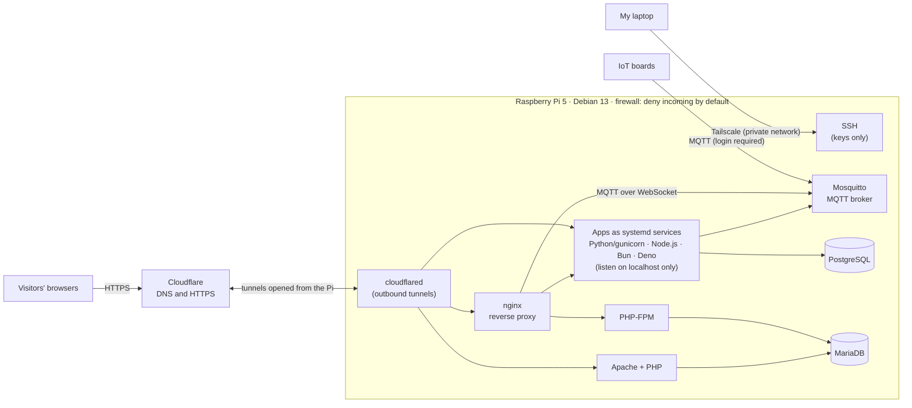

# Architecture

One Raspberry Pi 5 at home. It has three ways in:

1. **Websites**: visitors → Cloudflare → a Cloudflare Tunnel → a service on the Pi.
2. **Admin access**: my laptop → Tailscale → SSH.
3. **IoT boards**: MQTT to the Mosquitto broker, with a login required.

## Why Cloudflare Tunnel

A tunnel is an **outbound** connection. `cloudflared` on the Pi connects out to Cloudflare and keeps
that connection open. When someone visits a site, Cloudflare sends the request down the connection
the Pi already opened. So:

- no ports for the websites are forwarded on my home router,
- my home IP address is not in DNS (the site names point at Cloudflare),
- HTTPS certificates are handled by Cloudflare, and the Pi's web servers only speak plain HTTP on the Pi itself.

My own sites and each client site use **separate tunnels**, each run by its own systemd service. A
problem with one tunnel, or its credentials, doesn't touch the others.

Each tunnel has a list of ingress rules: "this hostname goes to this local address". The last rule
returns 404 for anything else. Example: [configs/cloudflared/config.example.yml](../configs/cloudflared/config.example.yml).
A hostname goes either to nginx (static files, reverse proxy, PHP) or straight to an app on localhost.

## How a request travels

Example: a student's browser calls `https://classroom.example.com/api/projects`.

1. **DNS.** In Cloudflare, the hostname points at the tunnel.
2. **Cloudflare** ends the HTTPS connection, adds the visitor's real IP in the `CF-Connecting-IP`
   header, and sends the request down one of the tunnel's connections.
3. **cloudflared** checks its ingress rules. The hostname matches `http://localhost:80` (nginx).
4. **nginx** picks the `server` block for that hostname:
   - it takes the visitor's IP from `CF-Connecting-IP`, trusting that header only from the Pi itself, so logs show real visitors;
   - it sends any request that arrived as plain HTTP to HTTPS;
   - for `/api/` it removes the `/api` prefix and proxies to the API on `127.0.0.1:<api-port>`.
5. **gunicorn** (3 workers × 2 threads, running as its own service user) runs the Flask app, which reads
   PostgreSQL on localhost and talks to Mosquitto.
6. The response goes back the same way: nginx (adds security headers) → cloudflared → Cloudflare → browser.

See [configs/nginx/iotstudio.conf](../configs/nginx/iotstudio.conf).

## Admin access

- **Tailscale** puts the Pi and my laptop on a private WireGuard network. I connect with **Tailscale SSH**
  in "check" mode, which asks me to confirm the login in the browser now and then.
- **OpenSSH** is a fallback for my home network only, and it accepts **keys only**.
- SSH is not reachable from the internet.

## MQTT

- **Two separate brokers**: one for IoT Studio, and one for the Makers cloud, which only listens on localhost.
- **Login required** on both (`allow_anonymous false`). Device accounts are managed by the backend
  through Mosquitto's Dynamic Security plugin.
- **IoT boards** connect to the broker directly; TLS is available for encrypted connections.
- **Browsers** reach MQTT through nginx as a WebSocket at `/mqtt`, over the same Cloudflare tunnel as
  the website, so that path needs no open port.

See [configs/mosquitto/iotstudio.conf](../configs/mosquitto/iotstudio.conf).

## What listens where

- **Apps, databases and the WebSocket side of MQTT** listen on `127.0.0.1` (localhost) only.
- **nginx and the MQTT broker** also listen on the network, but the firewall decides who can reach
  them (see [security.md](security.md)).
- **Website traffic** never needs an open port, because it arrives through the tunnels.
